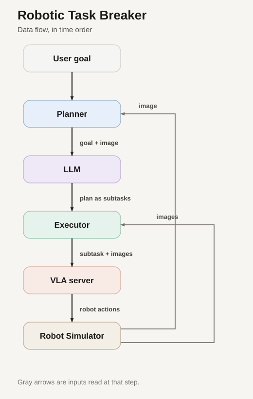

# Robotic Task Breaker

## Contents

- [About](#about)
- [How Robotic Task Breaker works](#how-robotic-task-breaker-works)
- [Architecture](#architecture)
- [Data Flow](#data-flow)
- [Engineering practices](#engineering-practices)
- [Research evidence](#research-evidence)
- [Research conclusions](#research-conclusions)
- [Install locally](#install-locally)
- [Run Robotic Task Breaker and the comparison](#run-robotic-task-breaker-and-the-comparison)

## About

Robotic Task Breaker is a research prototype testing whether an LLM can split a multi-step robot task into subtasks that help a vision-language-action (VLA) policy—a model that chooses robot actions—complete the task.

In its main experiment, a two-stage drawer task (open, then close) in the RoboCasa simulator, Robotic Task Breaker succeeded in 16 of 20 episodes, versus 2 of 20 for the same VLA acting alone. It used a mid-size VLA (GR00T N1.6, 3B parameters) and a low-cost LLM planner (`gpt-4.1-mini`).

To see what this result means and where it stops holding, read the [Research conclusions](#research-conclusions). For the numbers and details, see the [Research evidence](#research-evidence).

## How Robotic Task Breaker Works

1. Robotic Task Breaker gives an LLM the task goal and one image of the initial scene.
2. The LLM returns an ordered plan of short subtasks.
3. Robotic Task Breaker sends the VLA one subtask instruction for each subtask, for example `open the right drawer`.
4. The VLA decides the robot's actions, while Robotic Task Breaker checks whether the current subtask is complete (using info from the simulator).
5. Robotic Task Breaker repeats this for each planned subtask, then stops.
6. In case the VLA failed to complete a subtask - Robotic Task Breaker re-plans via the LLM.


## Architecture

- **[Runner](src/runner.py)** runs one episode. It connects the planner, simulator, and executor, then reports whether the task succeeded.
- **[Planner](src/planner.py)** asks an LLM for the ordered subtasks, using the goal and one image of the scene.
- **[Executor](src/executor.py)** runs one subtask at a time. It asks the VLA for actions and applies them until that subtask ends.
- **[SimEnv](src/envs/sim_env.py)** is the simulator interface used by the rest of Robotic Task Breaker. It forwards observations, actions, and checks to the backend.
- **[RoboCasaEnv](src/envs/robocasa_env.py)** is the RoboCasa backend. It renders the scene and steps the robot.
- **[VLAClient](src/vla_client.py)** sends images, robot state, and the subtask text to the VLA service, then returns the actions.
- **[run_vla_server.py](services/run_vla_server.py)** starts the HTTP service in front of the selected VLA. The current service adapts GR00T.


## Data Flow




## Engineering Practices

- **Agent-assisted workflow.** Conventions are codified as [Cursor rules](.cursor/rules). Large changes follow a plan, implement, and review split across AI agents ([architect command](.cursor/commands/architect.md)).
- **Explicit contracts.** Module roles, dependency direction, and the VLA service's HTTP interface are specified in [SRD.md](SRD.md), the project's source of truth for architecture and evaluation.
- **Fail fast.** Missing runtime context raises a clear error instead of continuing silently. VLA actions reach the simulator unchanged, apart from shape and finiteness checks.
- **Pre-declared statistics.** The comparison's stopping rule (a first look at 20 episodes per arm with `p <= 0.01`, a final look at 50 with `p <= 0.04`) is fixed in advance and implemented in validation/m4_unpaired_stats.py.
- **Hermetic tests.** `pytest` needs no simulator, GPU, or network access, so it runs on an ordinary Windows machine.


## Research Evidence


### Main Result

In one evaluated condition—RoboCasa `open_close_drawer`—Robotic Task Breaker succeeded in `16/20` episodes (80%). The bare GR00T VLA succeeded in `2/20` (10%). This was an unpaired comparison, with one-sided Fisher's exact test of `p=8.32e-6`.

This is evidence that task decomposition helped on this task distribution, with this VLA and simulator. It does not show that decomposition generally improves VLAs.

Setup: VLA `nvidia/GR00T-N1.6-3B`, planner `gpt-4.1-mini`. Recorded at commit `826b8e5`, where Robotic Task Breaker planned once. Re-planning (step 6 above) was added later but only triggers after an explicit per-subtask step cap, which the default runtime does not set, so it still plans once.

### How the Comparison Was Run

Robotic Task Breaker sends the VLA one short instruction per subtask. The bare VLA receives the original composite instruction (`open the X, then close it`) for the whole episode. Success is the simulator's terminal check for both arms. Code: [Robotic Task Breaker arm](validation/run_robotic_task_breaker_arm.py), [bare-VLA arm](validation/run_bare_policy.py), [statistics](validation/m4_unpaired_stats.py). The full contract is in [SRD.md](SRD.md).

### Other VLA and Simulator Stacks

Of the five stacks documented in [SRD.md](SRD.md), only GR00T + RoboCasa reached a Robotic Task Breaker versus bare comparison:

- **GR00T N1.6 + RoboCasa:** the drawer subtasks worked (`open` 8/10; an open-then-close chain with a fixed plan 7/10). Two other tasks failed their subtask gates: KettleBoiling (0/5) and SnackSorting (0/10).
- **SmolVLA + LIBERO:** the first subtask failed in 4 of 4 runs. In a prompt sweep only 2 of 5 wordings led to a grasp, and the step budget was not the cause.
- **Pi05 + LIBERO:** one full Robotic Task Breaker run succeeded, but asked to grab the tomato sauce first, the VLA still went to the alphabet soup.
- **SmolVLA + VLABench:** 0/8 on `select_fruit` before running out of memory (not diagnostic).
- **Pi0-fast + VLABench:** bare VLA 6/10 on held-out `select_fruit`; Robotic Task Breaker 0/10 on `cook_dishes` (6 physical stalls, 4 subtask-check mismatches).

On LIBERO the VLAs followed the scene more than the prompt. An AI-assisted code review found no path leaking the original task text to the VLA, and the behavior fits a VLA fitted to the benchmark's fixed scene and instruction pairs. We did not run the control that would confirm this (an unrelated but valid instruction in the same scene), so it is a hypothesis, and the LIBERO runs are archival (raw outputs not committed, code removed). [LIBERO-PRO](https://arxiv.org/abs/2510.03827) independently reports that standard LIBERO evaluates on the training tasks, and that models scoring over 90% collapse under small perturbations, with outputs unchanged even when the instruction is corrupted.


## Research Conclusions

**Main lesson: finding a VLA, simulator, and task that work together is hard, and it decides whether task decomposition can be tested at all.** Decomposition only helps if the VLA was trained on each subtask, executes it reliably, and the simulator can check it.

A usable pair needs three things:

1. **Subtasks the VLA was trained on.** Subtasks outside its training prompts failed even on their own (RoboCasa KettleBoiling and SnackSorting).
2. **A VLA that follows the prompt, not just the scene.** The LIBERO VLAs did not, which looks like fitting to the benchmark's fixed scenes and instructions (a hypothesis we did not test).
3. **A simulator check that agrees with the scene.** Mismatches between the two contributed to the VLABench failures.

**Caveats.** The drawer result is best read as decomposition helping a VLA combine skills it already has. The bare VLA's composite instruction is not one of its training prompts, while each Robotic Task Breaker subtask is, so the experiment cannot separate task length from instruction format. Robotic Task Breaker also gets simulator handoff checks that the bare VLA lacks. The result does not show decomposition adding skills the VLA lacks, and a single task and scene cannot separate a general capability from fitting that scene. Not yet tested: tasks with more than two subtasks, perturbed scenes or reworded instructions, other VLAs or simulators, and real hardware.


## Install Locally

Local development works on Windows without the simulator:

```bash
python -m venv .venv
source .venv/Scripts/activate  # Windows Git Bash
# Linux/macOS: source .venv/bin/activate
pip install -r deps/requirements.txt
pip install -e .
pytest
```

Tests are hermetic: they need neither a simulator nor network access.

Copy `.env.example` to `.env` and set `OPENAI_API_KEY`. Do not commit secrets.
Runtime defaults are in `src/config.py`.

## Run Robotic Task Breaker and the Comparison


### Run One Demo Episode

Open [colab/run_robotic_task_breaker_task.ipynb](colab/run_robotic_task_breaker_task.ipynb). It installs
the RoboCasa and GR00T stack, then starts:

- the upstream GR00T server on `:5555`
- the Robotic Task Breaker HTTP adapter on `:8765`

It then runs one episode through `examples/run_robotic_task_breaker_task.py`.

### Run the Robotic Task Breaker vs Bare Comparison

Open [colab/run_m4.ipynb](colab/run_m4.ipynb).

1. Copy the setup sections from `run_robotic_task_breaker_task`.
2. In section 4, set `X`; start with `X=20`.
3. Run Robotic Task Breaker for `X` episodes, then run the bare VLA for `X` episodes.
4. Run the statistics section:
  - Make an early claim only if one-sided Fisher exact `p <= 0.01`.
  - Otherwise continue to `50` episodes per arm and decide at `p <= 0.04`.

Artifacts are written to the run artifact directory on Drive.